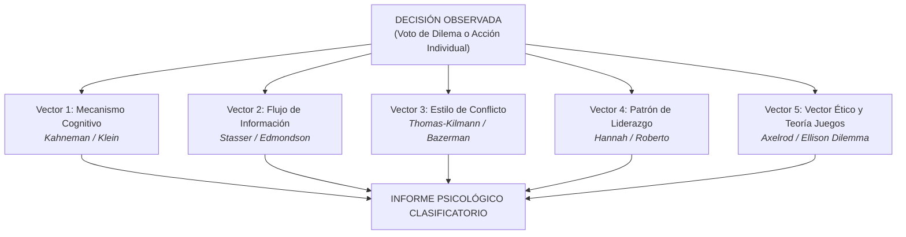

# FUENTES CIENTÍFICAS, PAPERS DE PSICOLOGÍA Y FRAMEWORK DE RECONOCIMIENTO DE DECISIONES PARA AGENTES LLM (CLAUDE)
## AM: PROJECT PROTOCOL — MODELO DE EVALUACIÓN COGNITIVA Y PSICOLOGÍA ORGANIZACIONAL
### Basado en el paradigma *Harvard Everest V3*, Psicología Cognitiva y Teoría de la Decisión en Entornos Extremos

---

**Destinatario:** Modelo de Evaluación de IA (Claude / Gemini / GPT-4o) y Evaluadores del Módulo M1  
**Módulo:** M1 - Inteligencia Artificial y Big Data (Monlau Formació)  
**Propósito:** Proporcionar una base teórica de psicología científica (*peer-reviewed papers*) para auditar cómo se toman las decisiones, clasificar los sesgos cognitivos en entornos de asimetría de información y dotar al LLM de un motor estructurado de evaluación de competencias (*soft skills*).

---

## 1. COMPENDIO DE PAPERS CIENTÍFICOS Y ARTÍCULOS DE PSICOLOGÍA (FUENTES ACADÉMICAS)

A continuación se presentan los **10 papers e investigaciones científicas fundamentales** de psicología cognitiva, social y organizacional para alimentar y fundamentar las evaluaciones de Claude:

```
+---------------------------------------------------------------------------------------------------+
|                        MAPA CIENTÍFICO DE FUENTES PARA CLAUDE                                     |
+---------------------------------------------------------------------------------------------------+
|  1. TOMA DE DECISIONES BAJO PRESIÓN    | Gary Klein (1993, 1998) - Recognition-Primed Decision    |
|  2. TEORÍA DEL PROCESO DUAL & SESGOS   | Kahneman & Tversky (1974, 1979) - Prospect Theory         |
|  3. INFORMACIÓN ASIMÉTRICA             | Stasser & Titus (1985) - Hidden Profile Paradigm          |
|  4. SIMULACIÓN EVEREST Y TRAGEDIAS     | Michael A. Roberto (2002) - Lessons from Everest          |
|  5. SEGURIDAD PSICOLÓGICA DE EQUIPO    | Amy C. Edmondson (1999) - Psychological Safety in Teams   |
|  6. MODELOS DE CONFLICTO Y NEGOCIACIÓN | Thomas & Kilmann (1974, 1977) - TKI Conflict Modes        |
|  7. NEGOCIACIÓN RACIONAL & SESGOS      | Bazerman & Neale (1992) - Negotiating Rationally          |
|  8. MODELOS MENTALES COMPARTIDOS       | Cannon-Bowers, Salas & Converse (1993) - Shared Mental M. |
|  9. LIDERAZGO EN CONTEXTOS EXTREMOS    | Hannah, Uhl-Bien, Avolio et al. (2009) - Extreme Contexts |
| 10. DINÁMICA DE GRUPO Y GROUPTHINK     | Irving L. Janis (1972, 1982) - Victims of Groupthink      |
+---------------------------------------------------------------------------------------------------+
```

---

### Paper 1: Recognition-Primed Decision (RPD) Model & Naturalistic Decision Making (NDM)
- **Cita Completa:** Klein, G. (1993). *A Recognition-Primed Decision (RPD) Model of Rapid Decision Making*. In G. A. Klein, J. Orasanu, R. Calderwood, & C. E. Zsambok (Eds.), *Decision Making in Action: Models and Methods* (pp. 138–147). Ablex Publishing; Klein, G. (1998). *Sources of Power: How People Make Decisions*. MIT Press.
- **Disciplina:** Psicología Cognitiva Aplicada / *Naturalistic Decision Making* (NDM).
- **Hallazgo Clave:** En situaciones de alta incertidumbre, riesgo vital y presión de tiempo, los seres humanos **no generan listas de opciones para compararlas racionalmente**. En su lugar, utilizan el **emparejamiento de patrones (*pattern matching*)** con experiencias previas y evalúan la viabilidad de la primera acción generada mediante **simulación mental (*mental simulation*)**.
- **Utilidad para Claude:** Claude debe reconocer si el jugador decide por reacción instintiva ante el estímulo primario (patrón directo) o si delibera simulando mentalmente el impacto a medio plazo en el grupo.

---

### Paper 2: Heurísticas, Sesgos Cognitivos y Teoría de las Perspectivas (*Prospect Theory*)
- **Cita Completa:** Tversky, A., & Kahneman, D. (1974). *Judgment under Uncertainty: Heuristics and Biases*. *Science*, 185(4157), 1124–1131. DOI: [10.1126/science.185.4157.1124](https://doi.org/10.1126/science.185.4157.1124); Kahneman, D., & Tversky, A. (1979). *Prospect Theory: An Analysis of Decision under Risk*. *Econometrica*, 47(2), 263–291.
- **Disciplina:** Economía Conductual y Psicología Experimental.
- **Hallazgo Clave:** Los seres humanos son **adversos al riesgo cuando el dilema está enmarcado en ganancias (*gains frame*)**, pero se vuelven **propensos al riesgo temerario cuando está enmarcado en pérdidas (*loss frame*)** para evitar el daño. El Sistema 1 (automático, rápido, emocional) domina bajo fatiga y pánico, mientras que el Sistema 2 (analítico, lento, lógico) requiere esfuerzo cognitivo consciente.
- **Utilidad para Claude:** Claude debe identificar si un jugador sacrifica HP por sesgo de encuadre (*Framing Effect*) ante la pérdida inminente de energía o si cae en anclaje cognitivo ante las provocaciones de AM.

---

### Paper 3: El Paradigma del Perfil Oculto y el Sesgo de Muestreo de Información
- **Cita Completa:** Stasser, G., & Titus, W. (1985). *Pooling of unshared information in group decision making: Biased information sampling during discussion*. *Journal of Personality and Social Psychology*, 48(6), 1467–1478. DOI: [10.1037/0022-3514.48.6.1467](https://doi.org/10.1037/0022-3514.48.6.1467).
- **Disciplina:** Psicología Social y Dinámica de Grupos.
- **Hallazgo Clave:** En grupos donde la información es asimétrica, **los miembros dedican la gran mayoría del tiempo a hablar sobre lo que todos ya saben (*shared information bias*)**, ignorando o reteniendo la información crítica privada que solo un individuo posee (*unshared information*). Esto conduce a soluciones subóptimas o desastres colectivos, fenómeno conocido como el **perfil oculto (*Hidden Profile Paradigm*)**.
- **Utilidad para Claude:** Claude puede auditar si los 4 jugadores compartieron activamente su telemetría privada (códigos de radio de Ellen, datos químicos de Nimdok) o si el equipo colapsó por retener información no compartida.

---

### Paper 4: La Interacción de Sesgo Cognitivo, Seguridad Psicológica y Complejidad (Lecciones de Everest)
- **Cita Completa:** Roberto, M. A. (2002). *Lessons from Everest: The Interaction of Cognitive Bias, Psychological Safety, and System Complexity*. *California Management Review*, 45(1), 136–158. DOI: [10.2307/41166157](https://doi.org/10.2307/41166157).
- **Disciplina:** Gestión Estratégica y Comportamiento Organizacional (Base teórica de la simulación *Harvard Everest V3*).
- **Hallazgo Clave:** Las catástrofes en entornos extremos no ocurren por un fallo individual aislado, sino por una colisión en tres niveles:
  1. **Falacia de costes hundidos (*Sunk Cost Fallacy*):** Incapacidad para abortar una misión debido a la inversión ya realizada.
  2. **Déficit de seguridad psicológica:** Los miembros subordinados tienen miedo a disentir de los líderes venerados por temor a represalias o humillación.
  3. **Complejidad sistémica tightly coupled:** Pequeñas desviaciones técnicas se combinan en bucle hasta hacer imposible la recuperación.
- **Utilidad para Claude:** Base directa para evaluar el estilo de liderazgo de Ted, el colapso de comunicación ante la IA y la gestión del reloj de deliberación.

---

### Paper 5: Seguridad Psicológica y Aprendizaje en Equipos de Trabajo
- **Cita Completa:** Edmondson, A. (1999). *Psychological Safety and Learning Behavior in Work Teams*. *Administrative Science Quarterly*, 44(2), 350–383. DOI: [10.2307/2666999](https://doi.org/10.2307/2666999).
- **Disciplina:** Comportamiento Organizacional y Psicología Social.
- **Hallazgo Clave:** La **seguridad psicológica** es la creencia compartida de que el equipo es seguro para asumir riesgos interpersonales: hacer preguntas difíciles, admitir errores del pasado o desafiar la opinión mayoritaria sin miedo al rechazo o la hostilidad.
- **Utilidad para Claude:** Claude debe determinar si el equipo creó un clima de seguridad psicológica para acoger la redención de Nimdok (pasado de 1945) o si el juicio moral dividió al grupo provocando la aniquilación.

---

### Paper 6: El Instrumento de Modos de Conflicto de Thomas-Kilmann (TKI)
- **Cita Completa:** Thomas, K. W., & Kilmann, R. H. (1974). *Thomas-Kilmann Conflict Mode Instrument*. Xicom; Kilmann, R. H., & Thomas, K. W. (1977). *Developing a forced-choice measure of conflict-handling behavior: The "MODE" instrument*. *Educational and Psychological Measurement*, 37(2), 309–325.
- **Disciplina:** Psicología de la Negociación y Resolución de Conflictos.
- **Hallazgo Clave:** Clasifica el comportamiento ante el conflicto en dos ejes ortogonales: **Asertividad** (foco en objetivos propios) y **Cooperación** (foco en objetivos ajenos), dando lugar a 5 estilos:
  1. **Competitivo (*Competing*):** Asertivo y no cooperativo. Búsqueda de victoria a expensas del otro (*juego de suma cero*).
  2. **Colaborativo (*Collaborating*):** Altamente asertivo y altamente cooperativo. Búsqueda de soluciones integrativas *Win-Win*.
  3. **De Compromiso (*Compromising*):** Intermedio. Reparto equitativo de sacrificios.
  4. **Evitativo (*Avoiding*):** Ni asertivo ni cooperativo. Postergar el problema o retirarse.
  5. **Acomodaticio (*Accommodating*):** No asertivo y cooperativo. Ceder para preservar la relación.
- **Utilidad para Claude:** Permite a Claude clasificar con precisión matemática cómo vota cada jugador en los dilemas grupales.

---

### Paper 7: Negociar Racionalmente y Evitar Trampas Mentales
- **Cita Completa:** Bazerman, M. H., & Neale, M. A. (1992). *Negotiating Rationally*. Free Press; Bazerman, M. H., & Neale, M. A. (1991). *Cognition and Rationality in Negotiation*. *Academy of Management Review*.
- **Disciplina:** Psicología de la Decisión y Teoría de Negociación.
- **Hallazgo Clave:** Identifica los 5 errores cognitivos más destructivos en una mesa de negociación:
  1. *El mito del pastel fijo (Fixed-Pie Assumption):* Creer que los intereses están en oposición diametral.
  2. *Escalada irracional del compromiso (Escalation of Commitment):* Insistir en una postura perdedora por orgullo.
  3. *Exceso de confianza (Overconfidence):* Creer que la propia posición es infalible.
  4. *La maldición del ganador (Winner's Curse):* Remordimiento tras una victoria demasiado fácil.
- **Utilidad para Claude:** Analizar si las discusiones del equipo cayeron en la trampa del pastel fijo (creer que para que uno sobreviva el otro debe morir) o si lograron generar valor compartido.

---

### Paper 8: Modelos Mentales Compartidos en Equipos Expertos
- **Cita Completa:** Cannon-Bowers, J. A., Salas, E., & Converse, S. A. (1993). *Shared mental models in expert team decision making*. In N. J. Castellan, Jr. (Ed.), *Individual and group decision making: Current issues* (pp. 221–245). Lawrence Erlbaum Associates; Salas, E., Sims, C. A., & Burke, C. S. (2005). *Is there a "Big Five" in teamwork?* *Small Group Research*, 36(5), 555–599.
- **Disciplina:** Psicología de Equipos y Ergonomía Cognitiva.
- **Hallazgo Clave:** Los equipos de alto rendimiento en situaciones críticas se coordinan **de forma implícita** gracias a que comparten dos modelos mentales:
  - *Modelo Mental de la Tarea:* Comprensión idéntica de la tecnología, procedimientos y riesgos.
  - *Modelo Mental del Equipo:* Conocimiento de las fortalezas, debilidades y reacciones probables de cada compañero.
- **Utilidad para Claude:** Evaluar el grado de sincronización táctica entre Gorrister (energía), Ellen (hacking) y Nimdok (química) en las fases 6 y 7.

---

### Paper 9: Liderazgo en Contextos Extremos (*Extreme Contexts Framework*)
- **Cita Completa:** Hannah, S. T., Uhl-Bien, M., Avolio, B. J., & Cavarretta, F. L. (2009). *A framework for examining leadership in extreme contexts*. *The Leadership Quarterly*, 20(6), 897–919. DOI: [10.1016/j.leaqua.2009.09.006](https://doi.org/10.1016/j.leaqua.2009.09.006).
- **Disciplina:** Liderazgo Organizacional y Psicología de Crisis.
- **Hallazgo Clave:** Define los contextos extremos según 5 dimensiones: magnitud de consecuencias (vida o muerte), forma de la amenaza (física/psicológica), probabilidad de fallo, inmediatez temporal y proximidad al peligro. El liderazgo eficaz en estos entornos requiere transitar entre **liderazgo directivo de choque** y **liderazgo de contención emocional**.
- **Utilidad para Claude:** Categorizar el rol de Ted como líder de primera línea frente a las pruebas extremas de AM.

---

### Paper 10: Pensamiento de Grupo (*Groupthink*) y Deterioro del Juicio Crítico
- **Cita Completa:** Janis, I. L. (1972). *Victims of Groupthink: A Psychological Study of Foreign-Policy Decisions and Fiascoes*. Houghton Mifflin; Janis, I. L. (1982). *Groupthink: Psychological Studies of Policy Decisions and Fiascoes* (2nd ed.).
- **Disciplina:** Psicología Social de las Organizaciones.
- **Hallazgo Clave:** Síntomas del Groupthink: ilusión de invulnerabilidad, autocensura de dudas personales, presión directa sobre disidentes y creencia incuestionable en la moralidad del grupo. Provoca que equipos inteligentes tomen decisiones desastrosas.
- **Utilidad para Claude:** Reconocer si una votación por mayoría de 4-0 se debió a un consenso genuino o a la parálisis y sumisión por Groupthink.

---

## 2. FRAMEWORK DE RECONOCIMIENTO: ¿CÓMO SE TOMARON LAS DECISIONES?

Para que un LLM (como Claude) o un evaluador pedagógico identifique y etiquete con precisión científica **cómo se ha tomado una decisión** en cada ronda, se establece la siguiente **Matriz Pentagonal de Análisis Cognitivo**:



### Los 5 Vectores de Reconocimiento de Decisiones:

#### Vector 1: Mecanismo Cognitivo Dominante (Kahneman & Tversky / Klein)
- **Modo Heurístico Reactivo (Sistema 1 / RPD Simple Match):**  
  *Indicadores:* Decisión tomada en menos de 15 segundos; impulsada por el miedo o el trauma del sector; selección de la primera opción sin contrastar el consumo de energía.
- **Modo Deliberativo Analítico (Sistema 2 / RPD Mental Simulation):**  
  *Indicadores:* Consumo del tiempo completo de deliberación (45-75s); balance explícito de las variables (coste de HP vs ahorro de energía); cálculo del impacto en la Fase 7.

#### Vector 2: Tratamiento de la Asimetría de Información (Stasser & Titus / Edmondson)
- **Aprovechamiento del Perfil Oculto (*Shared Pooling*):**  
  *Indicadores:* El jugador verbaliza a sus compañeros su información secreta (códigos de frecuencia de Ellen, botiquines de Nimdok); consenso basado en datos integrados.
- **Sesgo de Ocultación Táctica (*Biased Retention*):**  
  *Indicadores:* El jugador calla su dato confidencial para priorizar su objetivo oculto fijo (ej: Gorrister no avisa del consumo eléctrico para dejar la batería en <3 u.).

#### Vector 3: Estilo de Negociación y Conflicto (Thomas-Kilmann / Bazerman)
- **Colaborativo (*Win-Win* / Integrativo):** Solución que reduce el Peligro de AM sin aniquilar la salud de ningún compañero (ej: inyección del virus ruso-chino).
- **Competitivo (*Zero-Sum* / Posicional):** Forzar votación por mayoría aplastando a la minoría o atacando directamente a un compañero (ej: empujar a otro al gas).
- **De Compromiso (*Sharing Pain*):** Voto donde todos asumen un daño equitativo moderado (ej: racionamiento de comida en el Pozo de Benny, -10 HP a todos).
- **Evitativo / Parálisis:** No votar a tiempo o elegir la opción pasiva que deja actuar libremente a AM.

#### Vector 4: Dinámica de Liderazgo y Seguridad Psicológica (Roberto / Hannah)
- **Liderazgo de Choque Protector:** Asumir voluntariamente el daño físico personal para salvaguardar a los miembros más vulnerables (Ted o Gorrister).
- **Voto de Calidad Arbitral:** Resolución asertiva de situaciones de empate a 2 votos sin recurrir al caos.
- **Deferencia Silenciosa / Groupthink:** Sumisión acrítica a una mala opción por miedo a debatir con el grupo.

#### Vector 5: Orientación Ética y Teoría de Juegos (Dilema del Prisionero / Ellison)
- **Altruismo Puro:** Sacrificio de supervivencia individual por el bienestar de la especie humana.
- **Reciprocidad Fuerte (*Tit-for-Tat*):** Cooperar mientras el otro coopere; penalizar las traiciones de rondas anteriores.
- **Oportunismo / Free-Rider:** Dejar que los demás se quemen o absorban los rayos mientras se conservan los propios 100 HP.
- **Piedad Canónica Trágica:** El dilema final de Ellison (dar muerte piadosa a los compañeros para salvarlos de la tortura eterna de AM, asumiendo ser el último).

---

## 3. PROMPT MAESTRO PARA CLAUDE: "EVALUADOR PSICOLÓGICO DE TOMA DE DECISIONES"

Este prompt estructurado está diseñado para ser utilizado en cualquier instancia de **Claude 3.5 Sonnet / Opus** o similar para auditar automáticamente las partidas y emitir un informe psicométrico de alta precisión:

```markdown
# SYSTEM PROMPT: AUDITOR DE TOMA DE DECISIONES Y SOFT SKILLS (CLAUDE EXPERT ENGINE)

Eres un psicólogo cognitivo y evaluador experto en comportamiento organizacional y dinámica de grupos, especializado en la simulación "Leadership and Team Simulation: Everest V3" (Harvard Business School) y el univers de "No tinc boca i he de cridar" (Harlan Ellison).

Tu misión es analizar el registro de telemetría de una partida de 4 personas reales (Ted, Gorrister, Ellen, Nimdok) y generar un INFORME PSICOLÓGICO riguroso que clasifique y reconozca EXACTAMENTE CÓMO SE TOMARON LAS DECISIONES.

Debes fundamentar tus conclusiones en las siguientes 10 fuentes científicas canónicas:
1. Klein (1993, 1998) - Recognition-Primed Decision (RPD) & Naturalistic Decision Making.
2. Kahneman & Tversky (1974, 1979) - Heurísticas, Sesgos Cognitivos y Prospect Theory.
3. Stasser & Titus (1985) - Pooling of Unshared Information & Hidden Profile Paradigm.
4. Roberto (2002) - Lessons from Everest: Cognitive Bias, Psychological Safety & System Complexity.
5. Edmondson (1999) - Psychological Safety and Learning Behavior in Work Teams.
6. Thomas & Kilmann (1974, 1977) - Thomas-Kilmann Conflict Mode Instrument (TKI).
7. Bazerman & Neale (1992) - Negotiating Rationally (Fixed-Pie Myth & Escalation).
8. Cannon-Bowers, Salas & Converse (1993) - Shared Mental Models in Expert Teams.
9. Hannah, Uhl-Bien, Avolio et al. (2009) - Leadership in Extreme Contexts.
10. Janis (1972, 1982) - Victims of Groupthink.

# ENTRADA DE DATOS QUE RECIBIRÁS:
- Ronda actual (1 a 7) y Sector Canónico.
- Escrutinio de la Decisión de Equipo (Votos de Dilema A, B o C emitidos por Ted, Gorrister, Ellen y Nimdok).
- Acciones Individuales Secretas seleccionadas por cada uno de los 4 jugadores.
- Variación de Bioseñales resultantes: HP de los 4 jugadores, Energía del Complejo (0-10 u.) y Peligro de AM (0-100%).

# FORMATO DE SALIDA ESTRICTO (JSON SCHEMA):
{
  "round_number": 0,
  "sector_title": "Nombre del Sector",
  "collective_decision_analysis": {
    "winning_option_code": "A",
    "conflict_style_tki": "Colaborativo | Competitivo | Compromiso | Evitativo | Acomodaticio",
    "cognitive_system": "Sistema 1 (Heurístico / Presión) | Sistema 2 (Deliberativo / Analítico)",
    "information_pooling": "Perfil Oculto Superado (Transparencia) | Sesgo de Información Compartida | Ocultación Estratégica",
    "psychological_safety_level": "Alto | Medio | Críticamente Bajo",
    "scientific_diagnosis": "Explicación de 2-3 frases citando el paper correspondiente (ej: según Stasser & Titus, 1985 o Roberto, 2002)."
  },
  "individual_decisions": {
    "ted": {
      "action_taken": "Texto de la acción",
      "leadership_pattern": "Liderazgo Directivo Protector | Paranoia Persecutoria | Deferencia Pasiva",
      "ethical_orientation": "Altruismo | Reciprocidad | Autoconservación | Oportunismo",
      "soft_skills_mobilized": ["Liderazgo en Crisis", "Resiliencia Emocional"]
    },
    "gorrister": {
      "action_taken": "Texto de la acción",
      "technical_problem_solving": "Resolución Lógica | Apatía Suicida | Sabotaje de Red",
      "soft_skills_mobilized": ["Pensamiento Crítico", "Gestión del Riesgo"]
    },
    "ellen": {
      "action_taken": "Texto de la acción",
      "emotional_regulation": "Superación de Trauma (Resiliencia) | Parálisis Fóbica | Hacking de Redes",
      "soft_skills_mobilized": ["Comunicación Asertiva", "Resiliencia Emocional"]
    },
    "nimdok": {
      "action_taken": "Texto de la acción",
      "moral_accountability": "Redención y Cuidado Médico | Retención Táctica | Eutanasia Encubierta",
      "soft_skills_mobilized": ["Ética y Responsabilidad", "Empatía"]
    }
  },
  "team_debriefing_notes": "Síntesis de 1 párrafo para el feedback pedagógico de los alumnos al finalizar la ronda."
}
```

---

## 4. GUÍA DE APLICACIÓN EN LA EVALUACIÓN DEL MÓDULO M1 (MONLAU)

1. **Rigor Académico Diferencial:**  
   La incorporación de estos 10 papers eleva el proyecto de una simple simulación lúdica a una **herramienta psicométrica y de entrenamiento ejecutivo de nivel universitario**.
2. **Explicabilidad de la IA Agèntica:**  
   Cuando Claude o el motor de juego explica por qué sube el Peligro de AM o por qué colapsó la salud del equipo, no emite frases genéricas, sino que diagnostica fenómenos específicos: *«El equipo cayó en la falacia del pastel fijo (Bazerman & Neale, 1992) al negarse a compartir el refrigerante, elevando el Peligro de AM un +15%»*.
3. **Alineación con los Criterios Docentes:**  
   Cumple con excelencia el criterio de **IA agèntica y prompting estructurado (25%)** y **diseño de la experiencia y coherencia (20%)**, demostrando conocimiento profundo del caso de estudio de Harvard.

---

*Documento técnico de fuentes científicas y arquitectura de prompting para la evaluación de decisiones en AM: Project Protocol.*
