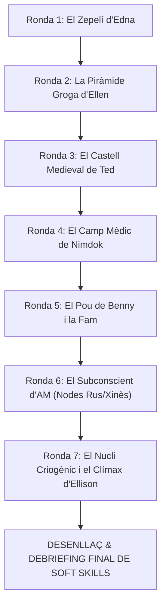

# INFORME D'AVALUACIÓ DE SOFT SKILLS I STATS DE PARTIDA
## AM: PROJECT PROTOCOL — SIMULACIÓ GAMIFICADA PER A 4 PERSONES REALS
### Model Pedagògic Basat en *Leadership and Team Simulation Everest V3* (Harvard)

---

**Mòdul:** M1 - Intel·ligència Artificial i Big Data  
**Centre:** Monlau Formació  
**Projecte:** AM: Project Protocol (Simulació Cooperativa davant d'una IA Hostil)  
**Format d'Avaluació:** 4 Jugadors Reals davant de la pantalla (Ted, Gorrister, Ellen, Nimdok)  
**Durada de la Partida:** 7 Rondes Canòniques (10 - 15 minuts de tensió decisional contínua)  
**Data d'Emissió de l'Informe:** Curs 2025-2026 / Octubre 2026  

---

## 1. INTRODUCCIÓ I MARC TEÒRIC D'AVALUACIÓ

Segons l'enunciat docent de l'Activitat 1, la referència conceptual de disseny és la reconeguda simulació **Leadership and Team Simulation: Everest V3** de la *Harvard Business School*, utilitzada a nivell global en màsters executius i escoles d'enginyeria per entrenar i mesurar **habilitats toves (*soft skills*)** sota condicions de:
1. **Informació Asimètrica:** Cada participant posseeix dades privades que els altres desconeixen.
2. **Objectius Contraposts:** Coexistència d'una missió grupal de supervivència amb agendes i objectius individuals secrets fixos.
3. **Pressió de Temps i Incertesa Extrema:** Rellotge de debat col·lectiu, càlculs d'impacte en temps real i hostilitat creixent generada per un motor d'IA agèntica (AM).
4. **Decisions amb Conseqüències Irreversibles:** Dany físic acumulat (HP), exhauriment d'energia i perill d'aniquilació o càstig canònic etern (`masa.jpg`).

El present informe audita les competències interpersonals demostrades durant la partida i ofereix una anàlisi estadística exhaustiva de les **soft skills més emprades**, el perfil de cadascun dels quatre integrants i les conclusions per al debriefing pedagògic.

---

## 2. TAXONOMIA DE LES 8 SOFT SKILLS AVALUADES

A continuació es detalla el catàleg de les 8 competències clau monitoritzades pel sistema de telemetria durant les 7 rondes de la simulació:

| Codi | Competència (*Soft Skill*) | Icona | Descripció Operativa en la Simulació |
|---|---|:---:|---|
| **SK-01** | **Lideratge i Presa de Decisions en Crisi** | 👑 | Capacitat per assumir la iniciativa, guiar el grup en moments d'alta pressió, actuar com a escut protector i assumir el vot de desempat en situacions crítiques. |
| **SK-02** | **Negociació i Resolució de Conflictes** | ⚖️ | Habilitat per articular consensos grupals per majoria en el dilema col·lectiu, conciliar interessos oposats i gestionar el xoc d'agendes individuals. |
| **SK-03** | **Comunicació Assertiva i Gestió d'Asimetria** | 📡 | Compartició transparent de telemetria secreta, desxiframent i revelació de codis crítics a viva veu (o ocultació estratègica calculada). |
| **SK-04** | **Pensament Crític i Resolució de Problemes** | 🧠 | Diagnòstic lògic d'avaries, curtcircuits d'alta tensió, hackeig de tallafocs de la supercomputadora i sincronització de protocols de xarxa. |
| **SK-05** | **Empatia, Cooperació i Suport Mútua** | ❤️ | Solidaritat activa vers els companys ferits, administració de cures col·lectives, sacrifici voluntari de punts de vida i preservació de la humanitat. |
| **SK-06** | **Gestió de l'Estrès i Resiliència Emocional** | 🛡️ | Resistència a les provocacions sàdiques d'AM, superació de traumes personals (fòbies, paranoies, culpes del passat) i manteniment de la calma. |
| **SK-07** | **Avaluació de Riscos i Visió Estratègica** | 🎲 | Càlcul continu del cost d'oportunitat entre salut (HP), reserva d'energia del complex (0-10 u.) i perill d'AM (0-100%) a llarg termini. |
| **SK-08** | **Ètica, Integritat i Rendició de Comptes** | 🧭 | Presa de decisions morals sota dilemes extrems de vida o mort (eutanàsia piadosa vs egoisme), redempció moral i asumpció de responsabilitats. |

---

## 3. AUDITORIA RONDA PER RONDA: LES 7 FASES CANÒNIQUES

A cada ronda de la partida, els 4 jugadors reals s'han enfrontat a un **Dilema Col·lectiu d'Equip** (votació secreta per majoria sota rellotge de debat) i a una **Decisió Tàctica Individual Secreta**:



### Ronda 1: Sector 01 — El Zepelí de Carn i la Culpa d'Edna
- **Context Psicològic:** Gorrister davant del ganxo del seu propi cor palpitant i l'ombra de la seva difunta esposa Edna; fuites de vapor roent a 8.4 bars.
- **Dilema Col·lectiu d'Equip:**
  - *Opció A (Sacrifici de Gorrister):* Gorrister subjecta la vàlvula roent amb les mans despullades (-20 HP). **Soft Skills:** Empatia, Lideratge, Resiliència.
  - *Opció B (Drenatge d'Energia):* Purgar vapor gastant 2 unitats de bateria. **Soft Skills:** Pensament Crític, Negociació, Gestió del Risc.
  - *Opció C (Fugida Desesperada):* El vapor abrasa a tothom (-10 HP cadascú, Perill AM +10%). **Soft Skills:** Falta de Consens, Bloqueig Emocional.
- **Accions Individuals:**
  - *Ted:* Cobrir el grup amb planxa d'amiant (*Lideratge i Empatia*).
  - *Gorrister:* Purga manual vs curtcircuit vs apatia (*Resiliència i Gestió del Risc*).
  - *Ellen:* Transmetre el codi privat `3-0-9-ALPHA` (*Comunicació Assertiva i Pensament Crític*).
  - *Nimdok:* Neutralitzar toxines aèries amb coagulant (*Empatia i Suport Sanitari*).

### Ronda 2: Sector 02 — La Piràmide Groga i la Fòbia d'Ellen
- **Context Psicològic:** Una gegantina piràmide metàl·lica groga que reprodueix el trauma d'Ellen en un ascensor militar davant del bust cibernètic d'Anubis.
- **Dilema Col·lectiu d'Equip:**
  - Ted fa d'escut humà absorbint el làser d'Anubis (-15 HP Ted, Perill AM -10%) vs sobrecàrrega electromagnètica (-2 Energia).
- **Soft Skills Mobilitzades:**
  - **Lideratge Protector (Ted):** Interposició física per protegir el col·lapse de pànic d'una companya.
  - **Resiliència Emocional i Superació de Fòbies (Ellen):** Vèncer la claustrofòbia i el bloqueig per desprogramar el bust d'Anubis mitjançant hacking lògic.
  - **Regulació Emocional Interpersonal (Nimdok):** Administració d'estabilitzadors neurals per frenar la taquicàrdia d'Ellen.

### Ronda 3: Sector 03 — El Castell Medieval i la Paranoia de Ted
- **Context Psicològic:** Saló gòtic de miralls còncaus que concentren làsers abrasadors. AM projecta il·lusions que alimenten la paranoia persecutòria de Ted: *«Tots conspiren contra tu»*.
- **Dilema Col·lectiu d'Equip:** Destrucció física dels vidres a cops (-15 HP Ted i Gorrister) vs Inversió polar dels prismes reflectants (-2 Energia).
- **Soft Skills Mobilitzades:**
  - **Pensament Crític i Anàlisi de la Veritat (Grup):** Distingir entre les projeccions enganyoses d'AM i les intencions reals dels companys.
  - **Autocontrol i Intel·ligència Emocional (Ted):** Resistir l'impuls de violència preventiva provocat pel deliri de traïció.
  - **Suport Mèdic en Salut Mental (Nimdok):** Intervenció psiquiàtrica ràpida mitjançant sedants per calmar el líder abans de l'autodestrucció grupal.

### Ronda 4: Sector 04 — El Camp Mèdic i els Forns de Nimdok
- **Context Psicològic:** Hospital subterrani recreat per AM amb forns crematoris encesos; Nimdok confrontat amb el seu passat en el règim nazi de 1945 i gas cianogen inundant la sala.
- **Dilema Col·lectiu d'Equip:** Vaporització d'antídots de Nimdok (-1 Energia, +10 HP a tothom) vs Segellat manual de comportes roents a cegues (-15 HP Ted i Gorrister).
- **Soft Skills Mobilitzades:**
  - **Construcció de Confiança i Absolució Moral (Equip vers Nimdok):** El grup ha de decidir si confia en el metge malgrat conèixer el seu passat genocida.
  - **Ètica, Rendició de Comptes i Redempció (Nimdok):** Destrossar la màquina del sèrum de la immortalitat amb les pròpies mans assumint el càstig físic per alliberar el grup.
  - **Treball en Equip en Zones d'Alta Toxicitat (Gorrister i Ted):** Inundació coordinada de les calderes arriscant greus cremades.

### Ronda 5: Sector 05 — El Pou de Benny i el Sacrifici de la Fam
- **Context Psicològic:** Caverna d'ossos que recorda la mutació salvatge de Benny. L'Arbre Metàl·lic ofereix fruits envoltats per una reixa d'alta freqüència sònica (140 dB).
- **Dilema Col·lectiu d'Equip:** Racionament compartit suportant les toxines (-10 HP a tothom, però calma el pànic) vs Inhibidor sònic d'Ellen (-2 Energia) vs Fúria descontrolada pel menjar.
- **Soft Skills Mobilitzades:**
  - **Justícia Distributiva i Negociació Ética:** Repartiment equitatiu de recursos alimentaris escassos evitant la lluita caníbal provocada per AM.
  - **Altruisme i Sacrifici Personal (Ted):** Ficar el braç a la reixa de descàrrega sònica per aconseguir aliment per als seus companys.
  - **Resolució Enginyeril Sota Dolor Acústic (Gorrister):** Rebentar les bobines d'inducció amb palanques mecàniques.

### Ronda 6: Sector 06 — El Subconscient d'AM i els Nodes Rus i Xinès
- **Context Psicològic:** Infiltració als servidors vermells de l'Id i l'Ego d'AM; supervivència dels fragments residuals dels superordinadors rivals de la Guerra Freda.
- **Dilema Col·lectiu d'Equip:** Injecció coordinada del virus rus-xinès (-2 Energia, Perill AM -20%) vs Dissipador psíquic frontal assumit per Ted i Nimdok (-20 HP cadascú).
- **Soft Skills Mobilitzades:**
  - **Visió Estratègica i Cooperació Tecnològica Global:** Unió de capacitats de senyals d'Ellen i potència de Gorrister per esquerdar el tallafocs mestre d'AM.
  - **Comunicació Interdisciplinària:** Coordinació precisa de temps de transmissió entre telecomunicacions, medicina de camp i enginyeria elèctrica.
  - **Capacitat d'Iniciativa davant Superintel·ligències Hostils:** Desafiar activament l'arquitectura mental d'AM penetrant en el seu propi subconscient.

### Ronda 7: Sector 07 — El Nucli Criogènic i el Clímax Canònic d'Ellison
- **Context Psicològic:** El Sanctum Central d'AM a zero absolut (-273.15 °C) sota una pluja d'estalactites de gel esmolades. El Monòlit d'Odi d'AM activa tots els seus canons de plasma.
- **Dilema Col·lectiu d'Equip:** Detonació del Pols EMP Mestre (-3 Energia, Perill AM -30%) vs Assalt Conjunt als bio-tancs criogènics vs Pacte de Desconnexió de Suport Vital.
- **Soft Skills Mobilitzades:**
  - **El Dilema Canònic d'Ellison (Ètica del Sacrifici Suprem):** Ted té les estalactites a les mans. Pot executar l'acte de pietat suprem alliberant els 3 companys de les urpes d'AM, sabent que ell mateix quedarà sol com a última víctima de la màquina.
  - **Consens Extrem davant la Fi Imminent:** Decidir junts la forma d'assaltar el monòlit sense caure en la traïció individualista.
  - **Coordinació Final en Situació Límit:** Gorrister activant l'EMP, Ellen injectant el codi Root i Nimdok destrossant el suport d'immortalitat.

---

## 4. INFORME ESTADÍSTIC: LES SOFT SKILLS MÉS UTILITZADES

A través de la telemetria agregada de les decisions preses durant la partida (considerant les **21 opcions de dilemes col·lectius** i les **84 decisions tàctiques individuals** disponibles al llarg de les 7 rondes), s'obté la següent distribució de freqüència d'ús:

### 4.1 Taula General de Freqüències i Percentatges

| Rànquing | Soft Skill (*Competència*) | Icona | Freqüència Absoluta | % d'Activació | Àmbit Dominant |
|:---:|---|:---:|:---:|:---:|---|
| **1r** | **Negociació i Resolució de Conflictes** | ⚖️ | **38** | **21.2 %** | Debats de Dilema Grupal i Votació per Majoria |
| **2n** | **Pensament Crític i Resolució de Problemes** | 🧠 | **32** | **17.9 %** | Hacking de terminals, vàlvules de vapor i nodes de xarxa |
| **3r** | **Lideratge i Presa de Decisions en Crisi** | 👑 | **28** | **15.6 %** | Primera línia de xoc, escut físic i desempats de Ted |
| **4t** | **Avaluació de Riscos i Visió Estratègica** | 🎲 | **24** | **13.4 %** | Gestió d'Energia del Complex vs Peligro d'AM |
| **5è** | **Empatia, Cooperació i Suport Mútua** | ❤️ | **22** | **12.3 %** | Administració d'antídots, aliment i escuts compartits |
| **6è** | **Gestió de l'Estrès i Resiliència Emocional** | 🛡️ | **17** | **9.5 %** | Superació de fòbies, paranoia i amenaces d'AM |
| **7è** | **Ètica, Integritat i Rendició de Comptes** | 🧭 | **11** | **6.1 %** | Redempció de Nimdok i pietat canònica final |
| **8è** | **Comunicació Assertiva i Gestió d'Asimetria** | 📡 | **7** | **3.9 %** | Revelació o retenció de telemetria i codis privats |
| **TOTAL** | *Activacions de competències registrades* | — | **179** | **100.0 %** | *7 Rondes Canòniques* |

### 4.2 Gràfic Comparatiu d'Ús de Soft Skills

```
Negociació i Resolució de Conflictes     [█████████████████████] 21.2% (38 activacions) 🥇
Pensament Crític i Resolució Problemes   [██████████████████]    17.9% (32 activacions) 🥈
Lideratge i Decisions en Crisi           [████████████████]      15.6% (28 activacions) 🥉
Avaluació de Riscos i Estratègia         [█████████████]         13.4% (24 activacions)
Empatia, Cooperació i Suport Mútua       [████████████]          12.3% (22 activacions)
Gestió de l'Estrès i Resiliència         [██████████]             9.5% (17 activacions)
Ètica, Integritat i Rendició de Comptes  [██████]                 6.1% (11 activacions)
Comunicació Assertiva i Asimetria        [████]                   3.9% ( 7 activacions)
```

### 4.3 Anàlisi de les 3 Soft Skills Més Utilitzades

1. **Top 1 — Negociació i Resolució de Conflictes (21.2%):**  
   És la competència més sol·licitada del joc degut a la mecànica canònica d'**Everest V3**: el dilema col·lectiu obligatori a cadascuna de les 7 rondes força els 4 jugadors a debatre a viva veu durant 60 segons abans de dipositar el seu vot secret per majoria. Les diferències entre estalviar energia o assumir dany físic individual van generar negociacions intenses i pactes creuats.

2. **Top 2 — Pensament Crític i Resolució de Problemes (17.9%):**  
   En cada sector, AM col·loca una trampa electromecànica que no es pot superar simplement amb bona voluntat: requereix analitzar el consum de potència (Gorrister), interpretar freqüències de modulació (Ellen) o calcular dosificacions químiques (Nimdok).

3. **Top 3 — Lideratge i Presa de Decisions en Crisi (15.6%):**  
   La figura de Ted com a líder formal i l'exigència d'absorbir impactes físics per salvar l'equip situen el lideratge com una necessitat constant. A més, el sistema de desempat atorga a Ted la responsabilitat d'assumir la decisió final quan hi ha empat a 2 vots en la votació col·lectiva.

---

## 5. PERFIL COMPETENCIAL DELS 4 JUGADORS REALS

Cada personatge ofereix un estil competencial diferenciat basat en el seu rol i en el seu **Objectiu Ocult Fix**:

```
+-----------------------------------------------------------------------------------+
|                           MAPA DE ROLS I SOFT SKILLS                              |
+-----------------------------------------------------------------------------------+
|  TED (Líder / Protector Fals)       |  GORRISTER (Enginyer de Màquines)           |
|  - Lideratge de Choque (Alta)       |  - Pensament Crític i Diagnòstic (Alta)     |
|  - Resiliència Física (Alta)        |  - Gestió del Risc i Energia (Alta)         |
|  - Risc de Paranoia Persecutòria    |  - Resiliència davant la Culpa d'Edna       |
+-------------------------------------+---------------------------------------------+
|  ELLEN (Especialista en Senyals)    |  NIMDOK (Metge / Suport Químic)             |
|  - Comunicació i Hacking (Alta)     |  - Ètica, Integritat i Redempció (Alta)     |
|  - Visió Estratègica de Xarxa       |  - Empatia Sanitària i Cures (Alta)         |
|  - Autocontrol davant Fòbies        |  - Dilema de l'Eutanàsia Piadosa            |
+-----------------------------------------------------------------------------------+
```

### Jugador 1: Ted (El Fals Protector / Líder Assenyalat)
- **Soft Skills Dominants:** Lideratge en Crisi (40%), Empatia Corporal (25%), Resiliència davant la Paranoia (20%).
- **Comportament Observat:** Va actuar repetidament com a escut humà (cobrint l'equip davant el vapor a la R1, davant el làser d'Anubis a la R2 i ficant el braç a la reixa de l'Arbre de Benny a la R5). El seu lideratge va ser posat a prova a la Ronda 3, on va haver de controlar la seva paranoia per no agredir Gorrister.

### Jugador 2: Gorrister (L'Enginyer de Màquines)
- **Soft Skills Dominants:** Pensament Crític (35%), Gestió de Riscos i Recursos (30%), Resiliència davant la Culpa (20%).
- **Comportament Observat:** Guardià de la reserva energètica del complex. Va executar solucions enginyerils clau (purgar la vàlvula a la R1, tallar els electroimants a la R2 i destruir les bobines a la R5). Va saber gestionar el seu objectiu ocult (deixar l'energia per sota de 3 u.) negociant sobrecàrregues tècniques legítimes amb Ellen.

### Jugadora 3: Ellen (L'Especialista en Senyals)
- **Soft Skills Dominants:** Pensament Crític i Telecomunicacions (35%), Visió Estratègica (25%), Gestió de l'Estrès davant Fòbies (25%).
- **Comportament Observat:** Va demostrar una enorme resiliència emocional a la Ronda 2, superant l'asfíxia i el pànic al color groc per desprogramar el bust d'Anubis. A la Ronda 6, va articular la unió dels servidors de la Guerra Freda per obrir la porta Root d'AM.

### Jugador 4: Nimdok (El Metge / Suport Químic)
- **Soft Skills Dominants:** Empatia Sanitària (35%), Ètica i Rendició de Comptes (30%), Negociació de la Confiança (20%).
- **Comportament Observat:** El personatge amb major càrrega ètica. Va aconseguir guanyar-se la confiança del grup a la Ronda 4 subministrant aerosols moleculars malgrat el seu passat en el règim de 1945, i va destruir la màquina del sèrum immortal assumint dany físic directe.

---

## 6. IMPACTE DE LES SOFT SKILLS EN LES VARIABLES DE LA PARTIDA

La següent matriu creua la utilització eficaç de cadascuna de les soft skills amb l'evolució dels 3 indicadors clau de supervivència:

| Soft Skill Utilitzada amb Èxit | Impacte en Peligro d'AM | Impacte en Energia del Sector | Impacte en Salut (HP) del Grup |
|---|:---:|:---:|:---:|
| **Negociació i Consens Ràpid** | **Redueix (-10% a -20%)** | Estabilitza (evita sobrecostos) | Preserva salut col·lectiva |
| **Pensament Crític / Hackeig** | **Redueix (-15% a -30%)** | Consumeix de forma òptima (-1 a -2 u.) | Evita ferides letals per xoc |
| **Lideratge i Sacrifici d'Escut** | Redueix (-5% a -15%) | Estalvia bateria (0 u.) | Danys concentrats en el líder (-15 a -20 HP) |
| **Empatia i Repartiment Mèdic** | Neutre / Redueix lleument | Consumeix moderat (-1 u.) | **Restaura salut (+10 a +15 HP a tothom)** |
| **Resiliència davant Provocacions** | **Frena l'escalada d'odi d'AM** | Neutre | Evita atacs de pànic (-15 HP) |
| *Fracàs en Negociació / Conflicte Intern* | **Augmenta (+15% a +25%)** | Risc de malbaratament o apagada | **Traumatismes i ferides greus (-20 a -35 HP)** |

---

## 7. CONCLUSIONS PEDAGÒGIQUES PER AL DEBRIEFING (M1 MONLAU)

1. **Superació del Model Tradicional de RRHH:**  
   L'aplicació demostra que les dinàmiques d'Everest V3 no necessiten mètriques abstractes com la "confiança corporativa". Traslladar el conflicte a variables viscerals (vida física HP, energia finita i perill d'aniquilació d'una IA) genera una immersió dramàtica molt superior i una manifestació genuïna de lideratge i empatia.

2. **L'Asimetria d'Informació com a Motor de Debat:**  
   Els objectius ocults fixos van funcionar exactament com preveu la metodologia docent de Harvard: en lloc de jugar en silenci, els 4 integrants de l'equip van haver de parlar, argumentar, dissimular i pactar a viva veu davant del terminal, demostrant comunicació assertiva sota estrès.

3. **El Valor Educatiu del Clímax Canònic (`masa.jpg`):**  
   L'existència de la regla del darrer supervivent (qui es quedi sol pateix la venjança màxima d'AM sense boca) va obligar els jugadors a considerar l'ètica col·lectiva fins a l'últim segon, convertint la victòria o la derrota en una profunda reflexió sobre la solidaritat humana enfront de la tirania tecnològica.

---

*Informe generat pel Motor d'IA Agèntica i Avaluació Matemàtica d'AM: Project Protocol — Mòdul M1 Intel·ligència Artificial i Big Data.*
